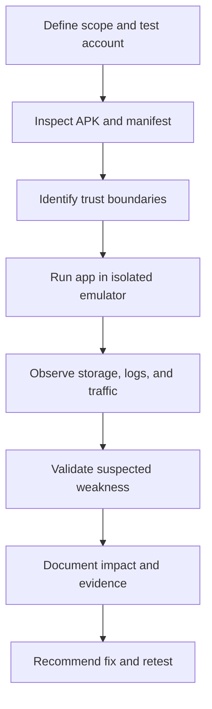

# Android Application Security Fundamentals

## 1. What is Android application security?

Android application security is the practice of protecting an app, its data, its communication, and the systems it connects to from unauthorized access, misuse, tampering, and disclosure.

An assessment considers several layers:

- **Application layer:** app logic, input handling, authentication, and authorization.
- **Platform layer:** Android permissions, app sandbox, components, and OS security features.
- **Data layer:** files, preferences, databases, caches, backups, and logs.
- **Network layer:** API requests, TLS, endpoints, and server responses.
- **Supply chain:** libraries, SDKs, build configuration, and signing.

## 2. Android application sandbox

Android normally assigns each installed app a distinct Linux UID and isolates its private files and processes. This app sandbox helps prevent one ordinary app from freely reading another app's private data.

The sandbox is a security boundary, not a guarantee that every item is secret. Data can still leak through:
- Explicitly shared or exported components.
- External/shared storage.
- Logs, backups, notifications, or screenshots.
- Vulnerable app logic or unsafe IPC.
- A compromised or rooted test device, depending on the threat model.

### Private app data

A common private data path is:

`/data/user/0/<package_name>/`

On many devices, `/data/data/<package_name>/` is also seen as a familiar path or alias. Access is normally restricted to the app's UID and privileged system contexts.

Typical contents may include:
- `shared_prefs/` — XML preference files.
- `databases/` — app databases.
- `files/` — app-managed files.
- `cache/` — temporary files.

Actual paths and access behavior can vary by Android version, device, and privilege level.

## 3. Android permissions

Permissions gate access to certain protected resources or actions. A permission is not a replacement for authorization inside the app or on its server.

Review:
- Which permissions are declared in `AndroidManifest.xml`.
- Which are requested at runtime.
- Whether each permission is necessary.
- Whether denial is handled safely.
- Whether sensitive functionality is protected by appropriate checks.

## 4. Inter-process communication (IPC)

Android apps communicate through mechanisms including:
- **Intents:** messages requesting an action or component.
- **Activities:** user-facing screens.
- **Services:** work that can run without a visible screen.
- **Broadcast receivers:** receive broadcast messages.
- **Content providers:** structured data access.

A component can create risk if it is unnecessarily exposed, trusts caller-provided data, or lacks suitable permission checks.

## 5. Authentication vs. authorization

- **Authentication:** Who are you?
- **Authorization:** What are you allowed to do?

A user being signed in does not automatically mean they may access every record or perform every action. Sensitive authorization decisions should be enforced by the server, not merely by hiding buttons or screens in the app.

## 6. Data at rest vs. data in transit

- **At rest:** information stored in files, preferences, databases, caches, or backups.
- **In transit:** information moving between the app and a server or other endpoint.

Encryption in one place does not solve every exposure. For example, a token may be encrypted at rest but leaked through logs, or sent insecurely over a network.

## 7. Static vs. dynamic analysis

| Method | What it examines | Examples |
|---|---|---|
| Static analysis | APK contents without running the app | Manifest review, code/resource inspection in JADX |
| Dynamic analysis | App behavior while running | ADB, Logcat, emulator observation, proxy inspection |
| Hybrid analysis | Combines both approaches | Trace a hard-coded endpoint in code, then observe its runtime requests |

Static analysis can reveal potential weaknesses, but findings should be validated when feasible. Dynamic analysis may miss behavior that only occurs under particular conditions.

## 8. A simple assessment loop

## 9. Secure testing habits

- Use an emulator and intentionally vulnerable apps for practice.
- Use dummy accounts and non-sensitive test data.
- Keep a record of the app version, Android version, and tool versions.
- Sanitize tokens, passwords, personal data, and device identifiers from screenshots.
- Separate confirmed findings from hypotheses.
- Do not test third-party apps or systems without authorization.
