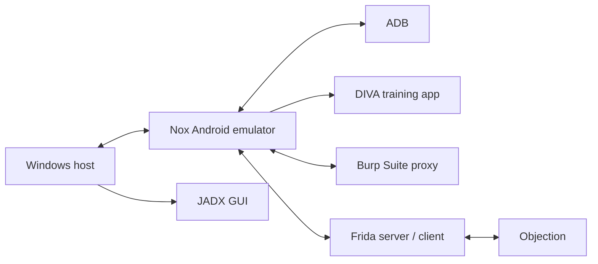

# Android Lab Setup and Tools

These notes reflect a controlled learning setup using **NoxPlayer**, the intentionally vulnerable **DIVA** app, ADB, JADX, Burp Suite, Frida, and Objection.

## 1. Lab layout



The exact network path depends on the emulator's network mode and proxy configuration. Confirm connectivity instead of assuming a particular IP address.

## 2. Tools and their roles

| Tool | Main use |
|---|---|
| NoxPlayer | Runs an Android emulator for lab testing |
| DIVA | Intentionally vulnerable Android training app |
| ADB | Device shell, package information, logs, file access where permitted |
| Logcat | Runtime logs and diagnostic messages |
| JADX GUI | Readable decompilation of DEX code and resource inspection |
| Apktool | Decoding resources/manifest and examining smali |
| Burp Suite | Intercepting and inspecting authorized HTTP(S) traffic |
| Frida | Dynamic instrumentation of a running process |
| Frida Server | Instrumentation service running in the test environment |
| Objection | Frida-based runtime exploration and mobile app testing helpers |

## 3. Check ADB connectivity

```bash
adb devices
```

If the emulator is not listed:
1. Confirm the emulator is running.
2. Check the emulator's documented ADB connection method.
3. Verify the correct ADB binary and port.
4. Re-run `adb devices` and confirm the device state is `device`, not `offline` or `unauthorized`.

Nox configurations vary. Avoid copying an ADB port from another setup without verifying it.

## 4. Basic ADB commands

List packages:

```bash
adb shell pm list packages
```

Filter for a known package name:

```bash
adb shell pm list packages | grep diva
```

On Windows Command Prompt, use `findstr` instead of `grep`:

```bat
adb shell pm list packages | findstr diva
```

Find installed APK paths:

```bash
adb shell pm path <package_name>
```

Open an interactive shell:

```bash
adb shell
```

View logs:

```bash
adb logcat
```

Clear the current log buffer before a controlled test:

```bash
adb logcat -c
```

Capture logs while reproducing a test:

```bash
adb logcat
```

Stop a continuous log stream with `Ctrl+C`. Logs can contain sensitive data; use dummy test values and sanitize evidence.

## 5. Burp Suite setup concepts

For authorized lab traffic:
1. Configure Burp's listener on an interface reachable from the emulator.
2. Configure the emulator's proxy to use the host address and listener port.
3. Confirm basic connectivity with a test request.
4. For HTTPS inspection, install and trust the Burp CA only in the disposable lab environment where appropriate.
5. If traffic does not appear, investigate proxy routing, certificate trust, app network-security configuration, and certificate pinning separately.

Do not disable certificate validation or weaken security settings in a real app as a workaround. Certificate pinning and Android trust behavior can affect whether a proxy sees HTTPS traffic.

## 6. Frida and Objection concepts

Frida allows runtime instrumentation of an app process. Objection provides a higher-level interactive interface for some mobile runtime inspection tasks.

Before testing:
- Match the Frida client and server versions.
- Match the server binary to the emulator's CPU architecture.
- Use a disposable, authorized emulator.
- Confirm the target process and app package.
- Record tool versions and errors.

A connection failure may be caused by a version mismatch, architecture mismatch, process permissions, or emulator configuration. Verify these before changing multiple variables at once.

## 7. Lab hygiene

- Use a snapshot or disposable emulator where possible.
- Use dummy usernames, passwords, and tokens.
- Do not put real secrets in screenshots or GitHub.
- Keep APKs and test artifacts from untrusted sources isolated.
- Record the Android version and tool versions in your notes.
