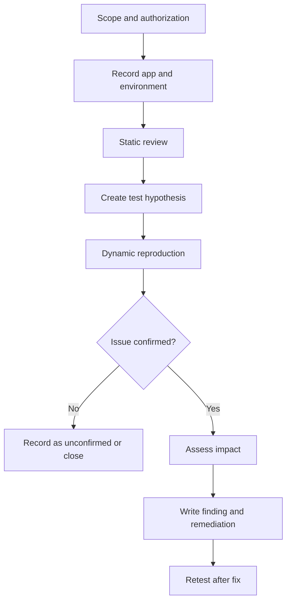

# Android Static and Dynamic Testing Workflow

## 1. Preparation

Record:
- App name and version.
- APK source and file hash, if useful.
- Android version and emulator/device model.
- Test account type and permissions.
- Testing scope and allowed techniques.
- Tool versions.

Use only an APK and system you are authorized to test.

## 2. Static analysis checklist

### Package and manifest
- [ ] Identify package name and app version.
- [ ] Review permissions.
- [ ] Review activities, services, receivers, and providers.
- [ ] Check exported components and component-level permissions.
- [ ] Review intent filters and deep links.
- [ ] Check debugging, backup, and cleartext-traffic settings.

### Code and resources
- [ ] Search for hard-coded credentials and token-like strings.
- [ ] Identify API endpoints and environment URLs.
- [ ] Review storage APIs and file paths.
- [ ] Review logging statements.
- [ ] Identify WebView use and JavaScript/interface configuration.
- [ ] Review cryptographic APIs and key handling.
- [ ] Identify third-party SDKs and libraries.

Static findings are leads, not always proof. Validate meaningful risks dynamically where possible.

## 3. Dynamic analysis checklist

- [ ] Launch the app and record baseline behavior.
- [ ] Use dummy data for each test.
- [ ] Observe logs while reproducing behavior.
- [ ] Review where sensitive values are stored.
- [ ] Observe network requests in an authorized test setup.
- [ ] Test permission-denied and error paths.
- [ ] Test deep links and component entry points where in scope.
- [ ] Confirm whether suspected issues are reproducible.

## 4. Storage testing questions

- Does the app store sensitive data it does not need?
- Is data written to logs, caches, external storage, or backups?
- Are tokens removed or invalidated at logout?
- Are encryption keys stored separately and protected appropriately?
- Can another ordinary app access the data, or does exposure require elevated privileges?
- Is the issue confirmed on the Android version under test?

## 5. Network testing questions

- Are sensitive requests sent over HTTPS?
- Is TLS certificate and hostname validation correct?
- Are secrets included in URLs or logs?
- Does the app send data to unexpected endpoints?
- Are server-side authorization checks enforced?
- Are errors exposing sensitive response details?

A proxy not showing traffic does not automatically mean traffic is secure or insecure. Consider routing, certificate trust, pinning, protocols, and whether the action actually triggered a request.

## 6. Evidence quality

Good evidence is:
- Reproducible.
- Relevant to the claim.
- Sanitized of credentials and personal information.
- Clear about environment and preconditions.
- Sufficient to distinguish a confirmed finding from a hypothesis.

Avoid uploading full device logs, real credentials, private customer data, or unredacted tokens to a public repository.

## 7. Mermaid overview

## 8. Report structure

1. Executive summary.
2. Scope and exclusions.
3. Environment and tools.
4. Methodology.
5. Findings with severity and evidence.
6. Recommendations.
7. Retest status.
8. Appendix containing sanitized supporting material.
