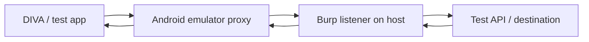

# Network Testing, Burp Suite, Frida, and Objection

## 1. Burp Suite and Android traffic

Burp Suite can act as an HTTP(S) proxy to help inspect traffic generated by an app during authorized testing.

A typical lab path is:

Actual routing depends on emulator networking and proxy configuration.

### What to observe
- Destination host and request path.
- HTTP method and status.
- Request/response structure.
- Whether sensitive values are sent.
- Whether the app handles errors safely.
- Whether authentication and authorization are enforced server-side.

Use synthetic values. Sanitize session cookies, authorization headers, tokens, and personal data before saving evidence.

## 2. HTTPS and certificate trust

HTTPS protects traffic in transit when TLS is correctly configured and validated. Interception in a lab may require trusting a proxy CA on the test device, but apps can use different trust settings or certificate pinning.

Key distinctions:
- **TLS validation:** checks that the server certificate is trusted and matches the hostname.
- **Certificate pinning:** adds an app-specific trust constraint in some designs.
- **Proxy configuration:** routes traffic through an inspection proxy; it does not by itself make HTTPS readable.
- **Cleartext traffic:** HTTP traffic may be visible to observers on the network and should not carry sensitive data.

Never recommend disabling TLS validation in production. If a test app resists interception, record the behavior and use an approved testing method.

## 3. Frida

Frida is a dynamic instrumentation toolkit that can observe or alter runtime behavior of a process in an authorized test environment.

Useful conceptual uses:
- Inspect runtime values that are not obvious from static code.
- Understand control flow and API calls.
- Validate a hypothesis about app behavior.
- Compare runtime behavior with what static analysis suggested.

Before troubleshooting, verify:
- Client/server version compatibility.
- CPU architecture of the target environment.
- Server process state.
- Correct package/process name.
- Emulator permissions and configuration.

Instrumentation can change app behavior, so treat runtime observations as evidence from a modified test environment.

## 4. Objection

Objection is a mobile runtime exploration toolkit built on Frida. It can help inspect app runtime behavior and perform supported checks without manually writing every instrumentation script.

Use it only within authorized testing scope. Record the exact command, tool version, target app, and observed output in private lab notes; sanitize anything sensitive before publishing.

## 5. Combining static and dynamic analysis

Example:
1. JADX reveals a URL or a function that appears to transmit a token.
2. Form a hypothesis about when that code executes.
3. Run the app with dummy data.
4. Observe requests using the configured lab proxy or logs.
5. Compare actual behavior with the hypothesis.
6. Record only the evidence needed to explain the issue.

## 6. Common troubleshooting checklist

| Symptom | Things to verify |
|---|---|
| Emulator absent from `adb devices` | Emulator state, ADB port, correct ADB binary, device authorization |
| Burp receives no requests | Proxy host/port, network route, app request behavior, protocol |
| HTTPS cannot be inspected | Test CA trust, Android trust settings, pinning, TLS behavior |
| Frida cannot attach | Version match, architecture, server process, package name, permissions |
| App crashes during testing | Baseline behavior, emulator compatibility, instrumentation side effects |
| Output contains secrets | Stop capture, redact artifacts, use dummy data, avoid public upload |

## 7. Reporting network findings

For each finding, include:
- Endpoint and method, with sensitive values redacted.
- Whether the request used HTTPS.
- The relevant data category, not the actual secret.
- Reproducible preconditions.
- Security impact.
- Recommended correction.
- Retest status.

A captured request is not automatically a vulnerability. Explain why the observed behavior violates a security requirement.
